BCE :- Bristol Communtiy Events Web Application
 
 A full-stack event booking platform built with Flask + MySQl, designed to manage Bristol's community events with a seamless user and admin experience.

OVERVIEW

 BCE lets users browse events, book tickets, manage multi-day bookings, receive discounts, join waiting lists, and download receipts, while admins manage events, venues, categories, occurrences, and booking through a dedicated dashboard.
 This project demonstrates strong backend logic, clean UI design, responsive layouts, and a fully normalised 3NF database.

KEY FEATURES 

 User Features
 - Browse and search events (category, date, month, free events)
 - View detailed event info (venue, price, remaining tickets, conditions)
 - Multi-day booking with automatic price calculation 
 - Advance booking discounts + student discounts
 - Capacity-aware booking with sold-out and low-availability alerts
 - Waiting list system with timestamp ordering 
 - Payment simulation + downloadable receipts
 - Dashboard for past and future bookings
 - Booking cancellation with correct charge rules 

 Admin Features
 - Secure admin login
 - Add / Edit / Delete events
 - Manage categories, venues, occurrences
 - View booking status (sold out, low availabilty, upcoming)
 - Full CRUD for event data
 - Basic reporting tools

TECH STACK
 - Backend: Python (Flask)
 - Frontend: HTML, CSS, JavaScript
 - Database: MySQL (3NF)
 - Templating: Jinja2
 - Version Control: Git + GitHub

PROJECT STRUCTURE

C:.
├───app
│   ├───routes
│   ├───static
│   │   ├───css
│   │   ├───images
│   │   └───js
│   └───templates
└───screenshots

DATABASE DESIGN

 - Fully normalised to 3rd Normal Form
 - Clear entity relationships (Users, Events, Occurrences, Bookings, Categories, Venues)
 - Junction tables for many-to-many relationships
 - Foreign keys enforce referential integrity
 - Secure password hashing + parameterised SQL

LESP SUMMARY

- Legal: Hashed passwords, GDPR-aligned data handling
- Ethical: No dark patterns, transparent booking and cancellation
- Social: Mobile-first responsive design, ARIA labels, WCAG AA contrast
- Professional: Modular Flask architecture, clean separation of concerns

SCREENSHOTS

(Some screenshots showing the various features of the website)
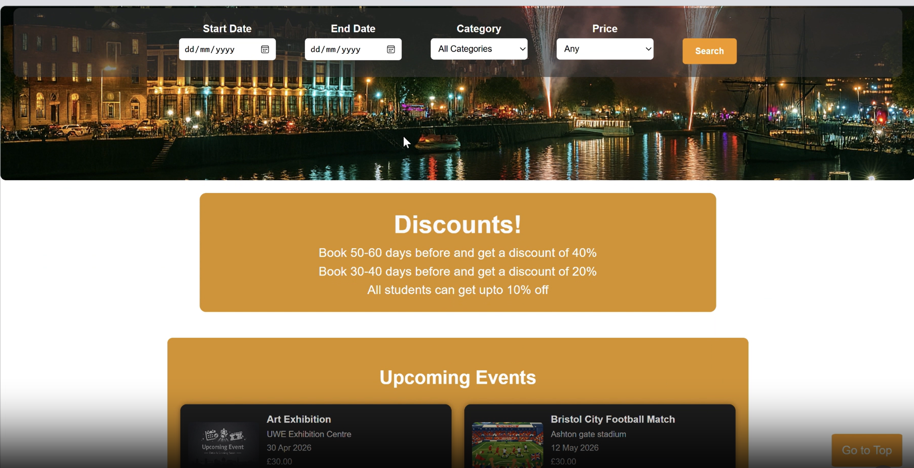
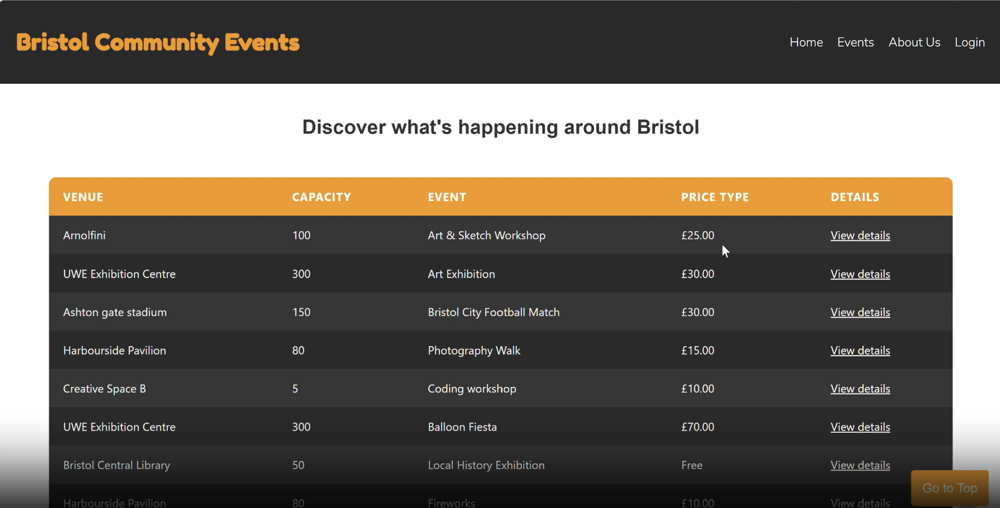
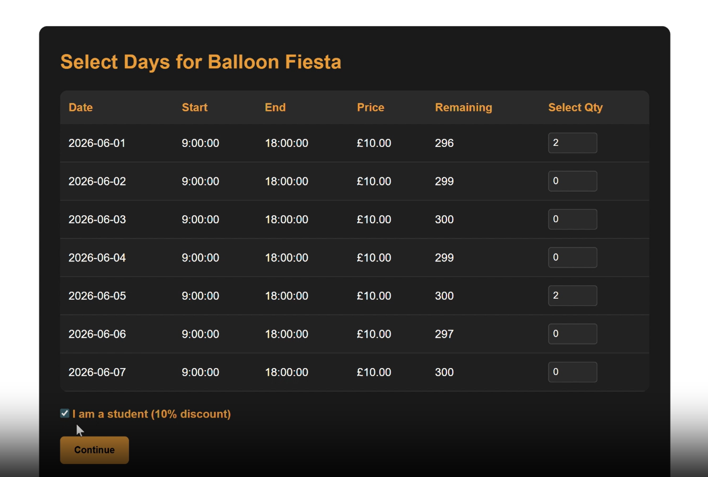
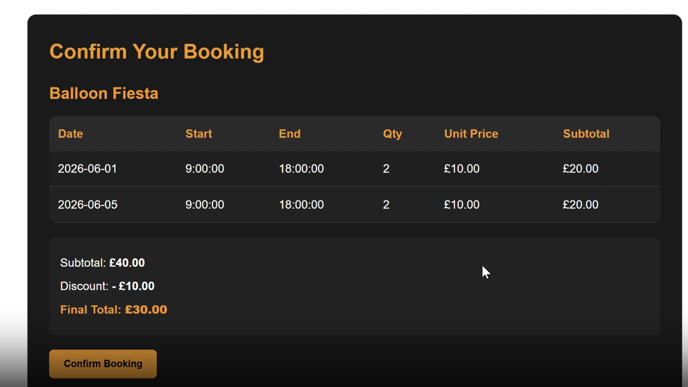
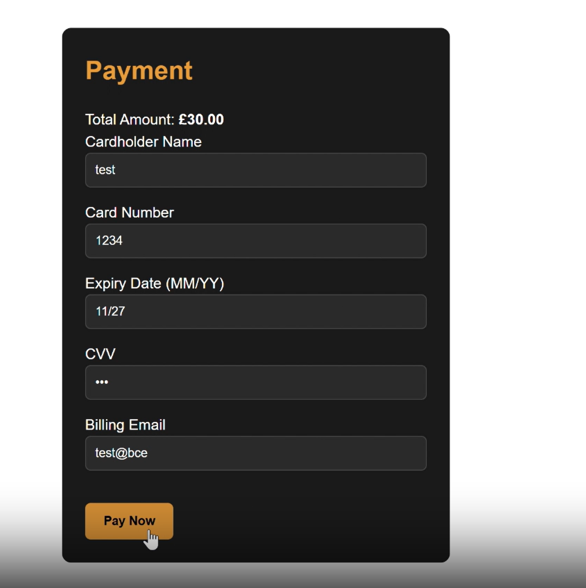
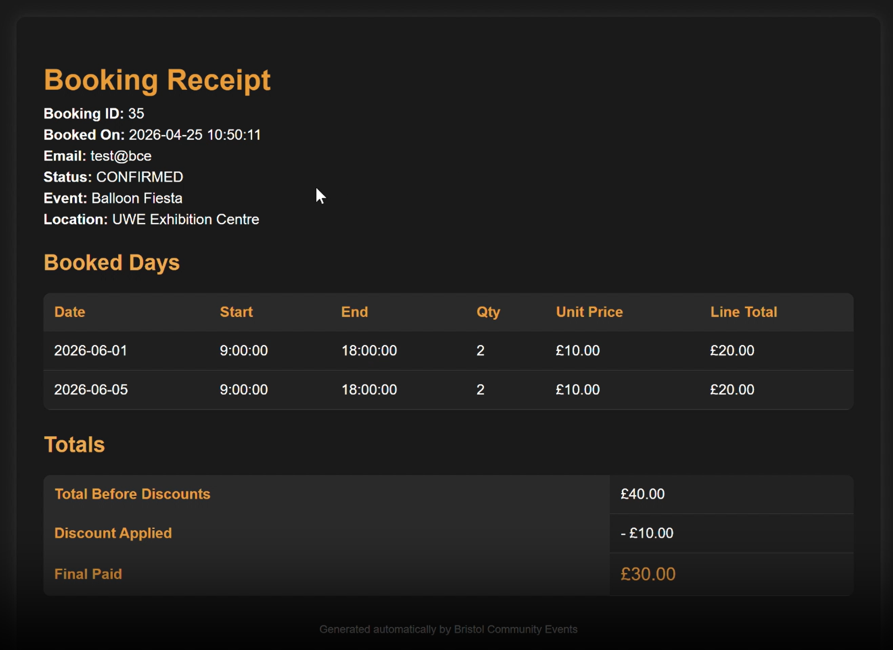
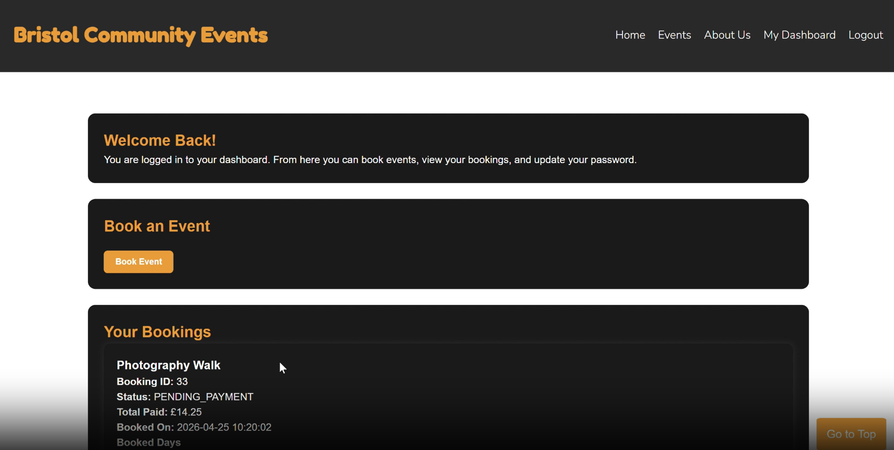
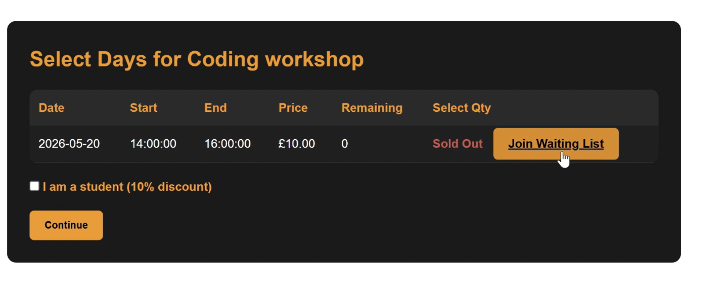
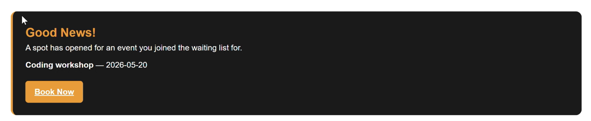
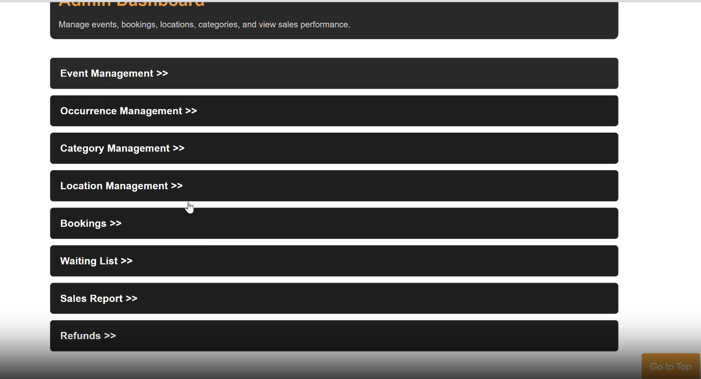
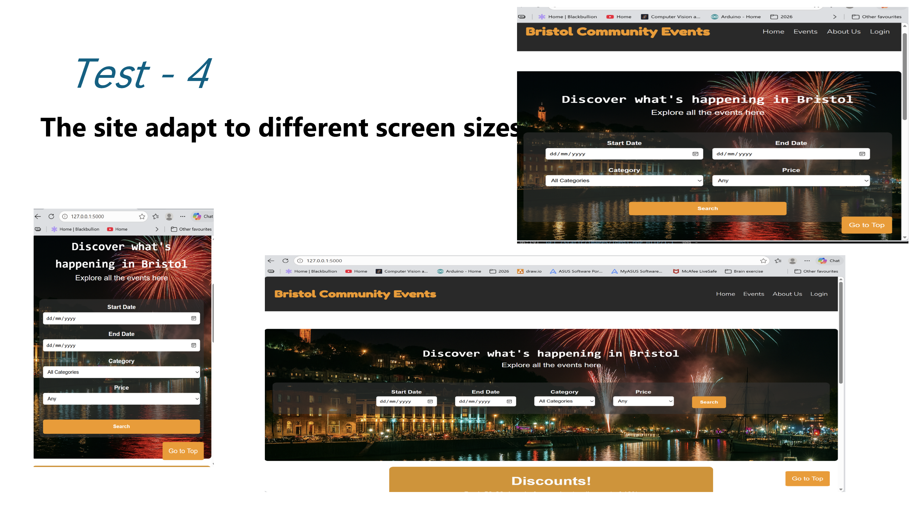
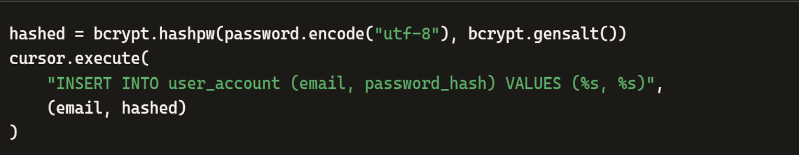
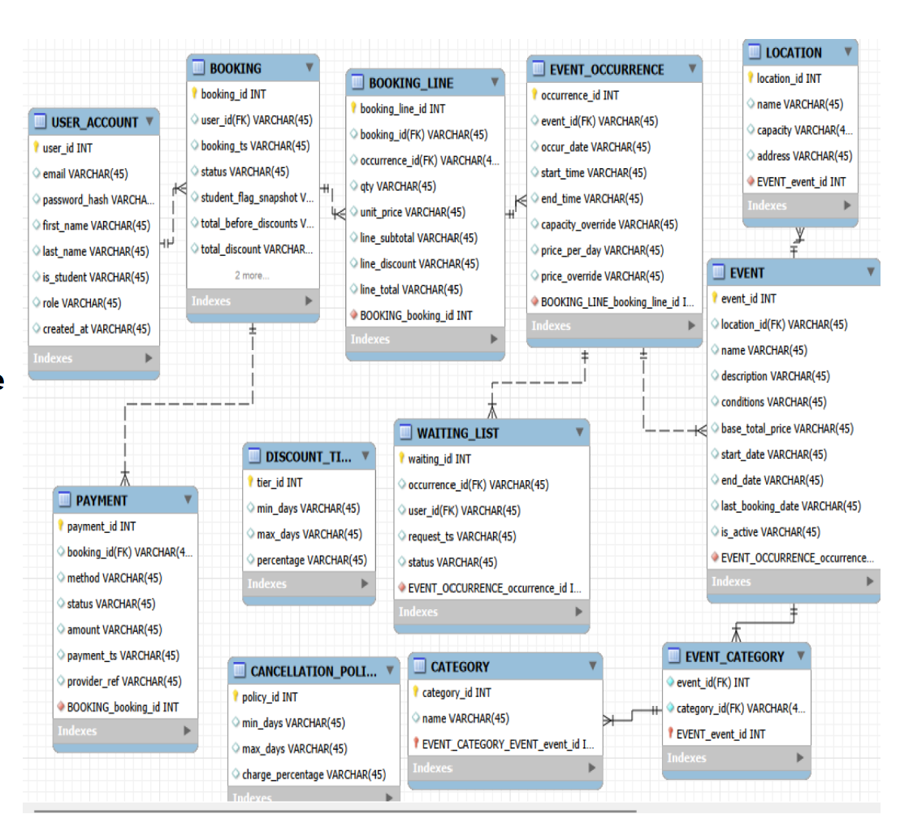

FUTURE IMPROVEMENTS

 - CSRF protection
 - Admin ability to update user passwords
 - Venue-specific analytics
 - Automatic email notifications for waiting list promotions
 - Calender date picker for bookings
 - Advanced reporting dashboard

HOW TO RUN

 - "cd BCE"
 - "python run.py"
 - visit "127.0.0.1:5000" 

AUTHOR

Priyanshi Jadeja    
BSc Computer Science - UWE Bristol.